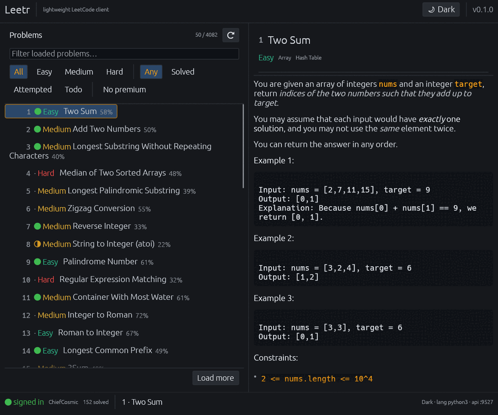
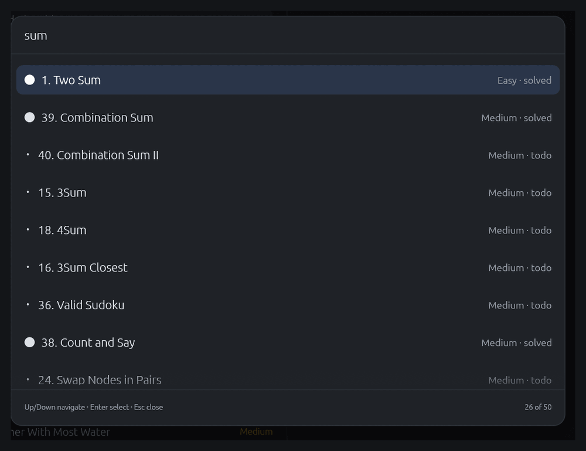
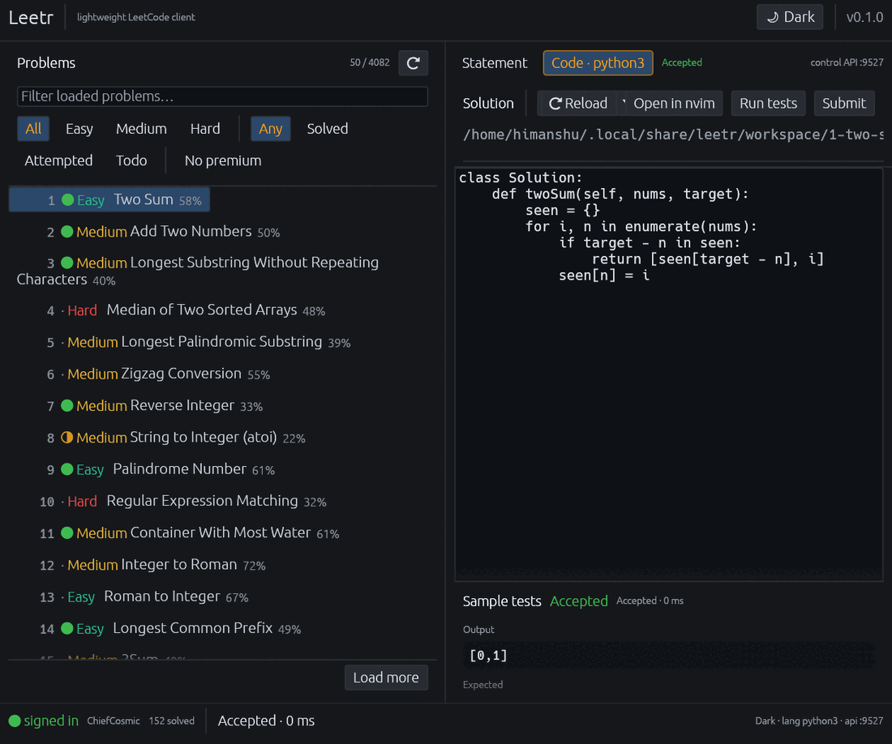

# Leetr

**NOTE:** This is purely vibe-coded slop I made to benchmark *DeepSeek V4.1 Flash*, stuff may (and will) break

A **lightweight** desktop LeetCode client in Rust with
[GPUI Kit](https://gpui-kit.com/) components — and first-class **nvim
interoperability** so you never copy-paste between your editor and
a browser again.



No embedded Chromium, no WebKit, no async runtime. One small native binary that reads
problems, runs your code and submits it, while **your own nvim** does the editing.

```
$ du -h target/release/leetr    43M
$ ldd target/release/leetr | wc -l
11
```

No embedded Chromium, no WebKit, no GTK, no OpenSSL, no async runtime — the
binary links only system windowing libraries (`libxcb`, `libxkbcommon`,
`libXau`, `libXdmcp`) plus `libc`, `libm` and `libgcc`.

---

## Features

| | |
| --- | --- |
| **Browse problems** | A [GPUI Kit sidebar](https://gpui-kit.com/component/sidebar) of 4000+ problems: collapsible groups, status/difficulty filters as menu items, solved/attempted markers and paging |
| **Read statements** | LeetCode's HTML rendered as real rich text: inline code, monospace examples, bullets, hints, starter code and **statement diagrams fetched and displayed inline** |
| **Edit with highlighting** | The [GPUI Kit editor](https://gpui-kit.com/component/editor) with tree-sitter syntax highlighting for **Python and C++**, plus auto-indent, bracket pairing and folding |
| **Submit solutions** | Run sample tests and submit, with a verdict panel showing runtime, produced vs expected output and compile/runtime errors |
| **nvim interoperability** | Edit in your own nvim; Leetr and nvim share a file on disk plus a loopback control API, so nothing is ever copy-pasted |
| **Dark mode** | A curated dark theme (default) and a matching light theme, persisted in `config.toml` |
| **Iosevka Nerd Font** | The whole interface is drawn in Iosevka Nerd Font when it is installed, loaded from the system so the binary stays small |
| **`Ctrl+P`** | Problem selector — fuzzy jump to any loaded problem, with difficulty/status filter chips and results grouped by status |
| **`Ctrl+K`** | Command palette — theme, reload, filters, links, quit |
| **Lightweight** | A **43 MB** release binary with no Chromium, no WebKit, no GTK, no OpenSSL and no async runtime |

### Command palettes

Both palettes are [GPUI Kit `Command`](https://gpui-kit.com/component/command)
palettes with section headers: `Ctrl+P` adds difficulty/status filter chips and groups
its results by status.

`Ctrl+P` ranks by fuzzy match with bonuses for word boundaries and contiguous runs, so
`sum` puts **Two Sum** first. When nothing matches locally, an inline
**"Search LeetCode for …"** action falls back to a server-side search — no per-keystroke
network traffic.



### The sidebar

The sidebar is the GPUI Kit `Sidebar` with grouped menu items, not a hand-drawn list:
collapsing it leaves an icon rail, the status/difficulty filters are menu items that carry
their own active state, difficulty is a collapsible submenu, and the open problem's actions
(run, submit, nvim, browser) live in their own group.

### Editing and running

The solution pane is the GPUI Kit `Editor`: tree-sitter highlighting, auto-indent, bracket
pairing, code folding, undo/redo and a right-click menu. Switching language rebuilds the
editor for that grammar; the file on disk stays the source of truth, so nvim and Leetr
remain interchangeable.

Highlighted languages are **Python and C++** — including C, which rides the C++ grammar,
and Python's LeetCode aliases (`pythondata`, `pandas`). Every other language opens as plain
text rather than failing. The set is one match arm in `editor_language` (`src/app.rs`) plus
the matching `tree-sitter-*` feature in `Cargo.toml`; nothing else needs to change.



---

## Install

```bash
git clone https://github.com/HimanshuSardana/leetr
cd leetr
cargo install --path .          # or: cargo build --release
```

Requirements: Rust 1.93+ (the `gpui-kit` 0.7 stack; see `rust-version` in
`Cargo.toml` for which dependency sets each floor), and on Linux the usual windowing headers
(`libxkbcommon`, `libxcb`, `libx11`, `libwayland`, `libgl`). Optional: `nvim`, `tmux`.

The first run writes default config to `~/.config/leetr/`.

## Credentials

Browsing problems and reading statements needs **nothing**. Running tests and submitting
needs a LeetCode session:

1. Log in to <https://leetcode.com>.
2. DevTools (F12) → **Application → Storage → Cookies → `https://leetcode.com`**.
3. Copy the `LEETCODE_SESSION` and `csrftoken` cookie values into
   `~/.config/leetr/credentials.toml`.
4. Restart Leetr — a **signed in** badge appears in the status bar.

Environment variables `LEETCODE_SESSION` and `LEETCODE_CSRFTOKEN` override the file.
`credentials.toml` lives outside the repository and is never committed.

```bash
leetr whoami    # verifies the session and reports how many problems you've solved
```

## Keybindings

| Shortcut | Action |
| --- | --- |
| `Ctrl+P` | Problem selector — fuzzy-jump to any loaded problem |
| `Ctrl+K` | Command palette — theme, reload, filters, links, quit |
| `Ctrl+O` | Open the current solution in nvim |
| `Ctrl+'` | Run the sample tests |
| `Ctrl+Enter` | Submit the solution (respects the [safety rail](#safety-rail)) |
| `Ctrl+B` | Collapse the sidebar to an icon rail |

While a palette is open it takes the keyboard instead:

| Shortcut | Action |
| --- | --- |
| `Up` / `Down` | Move the selection |
| `Enter` | Run the highlighted command / open the highlighted problem |
| `Esc` | Clear the query, then close the palette |

`Tab` is left to focus navigation everywhere, so typing a query and pressing Tab
never yanks you into another pane mid-query.

### Deliberate shortcut overrides

The global shortcuts shadow a built-in text-editing binding or two. That is a
choice, not an oversight:

* `Ctrl+K` claims the command palette, which is the usual convention for a
  global palette and is far more useful here than kill-line in a single-line
  filter box.

## CLI

The same client works headlessly:

```bash
leetr list --limit 20 --slug          # browse
leetr list --todo --search matrix     # filter (needs credentials)
leetr show two-sum                    # statement as readable terminal text
leetr show two-sum --raw              # raw statement HTML
leetr languages                       # submission languages
leetr whoami                          # verify the session
leetr install-nvim-plugin             # install the nvim plugin
```

## Editing: nvim interoperability

**A file on disk is the source of truth.**

```
~/.local/share/leetr/workspace/<id>-<slug>/
    solution.py     # both Leetr and nvim edit this
    problem.md      # the statement, readable offline
    meta.json       # ids / title / language
```

* Opening a problem creates the directory and seeds the solution from LeetCode's
  **boilerplate** for your configured language. An existing file is never overwritten.
* Saving in nvim updates Leetr: the app notices the file change and reloads.
* Editing in Leetr writes the file back, so `:e!` / `:LeetrPull` picks it up.
* **Open in nvim** launches your editor on the file. Inside tmux it opens a split,
  otherwise it uses `$TERMINAL`, otherwise plain `nvim`. Override with `editor_command`
  in `config.toml`.

### nvim plugin

```bash
leetr install-nvim-plugin        # writes ~/.config/nvim/lua/leetr.lua
```

Then add `require("leetr").setup()` to your nvim config.

| Command | Effect |
| --- | --- |
| `:LeetrStatus` | show what Leetr has open, plus the last verdict |
| `:LeetrOpen <slug>` | ask Leetr to open a problem |
| `:LeetrPull` | load Leetr's buffer into this window |
| `:LeetrPush` | send this buffer to Leetr |
| `:LeetrRun` | run the sample tests |
| `:LeetrSubmit` | submit, then report the verdict |
| `:LeetrResult` | show the last judge verdict |
| `:LeetrPort <n>` | point the plugin at another port |

Saving any `*/solution.*` file pushes it automatically, so the normal workflow is just
Leetr and nvim side by side.

### Control API

Leetr hosts a small API on `127.0.0.1:9527` (configurable) — loopback only:

| Method | Path | Purpose |
| --- | --- | --- |
| `GET` | `/health` | liveness + version |
| `GET` | `/state` | problem, language, file, code, solved flag, judge result |
| `GET` | `/code` | current buffer as text |
| `POST` | `/code` | replace the current buffer |
| `POST` | `/open` | open a problem by slug |
| `POST` | `/run` | run the sample tests |
| `POST` | `/submit` | submit the buffer (respects the solved-guard) |

Reads are served from a snapshot the UI publishes, so they never block. Writes are queued
and applied on the next frame — and they *wake* the UI, so an idle window still reacts.

## Safety rail

Leetr refuses to submit to a problem that is **not already marked solved** on your account,
and the refusal happens *before* any request reaches LeetCode — an attempt can never be
spent accidentally:

```
refusing to submit to `median-of-two-sorted-arrays`: it is not in your solved set.
Leetr only submits to problems you have already solved —
set `allow_unsolved_submit = true` in config.toml to override.
```

The Submit button is disabled for unsolved problems too, and if the solved set has not
loaded yet Leetr refuses rather than guessing.

Setting `allow_unsolved_submit = true` in `config.toml` turns the guard off — and because
that is exactly the kind of flag that is easy to leave switched on, doing so is **never
silent**: every submission to an unsolved problem then carries a warning in the verdict
panel, in the status bar and in `/state`, naming the problem and the config key.

## Architecture

```
src/
  app.rs           GPUI root view: state, panels, background work
  bg.rs            threads + channel plumbing (no async runtime)
  config.rs        config.toml + credentials.toml
  theme.rs         dark/light palettes, difficulty colours
  app.rs           also holds the sidebar groups and `editor_language`
  glyphs.rs        every UI symbol the interface paints
  (assets)         GPUI Kit's Lucide icon catalog, registered at startup
  fonts.rs         loads Iosevka Nerd Font from the system (GPUI fallbacks stay behind it)
  editor.rs        workspaces, per-language extensions, buffers, mtime reloading
  nvim.rs          editor launch strategy + embedded nvim plugin + installer
  interop.rs       loopback control API (tiny_http)
  img.rs           blocking HttpClient so GPUI can fetch statement diagrams
  model.rs         domain types, decoupled from the API schema
  leetcode/
    graphql.rs     query strings + wire types
    client.rs      blocking HTTP, auth, problem list, solved set
    html.rs        statement HTML -> rich-text blocks
    submit.rs      judge protocol, verdicts, solved-guard
  ui/
    problem_list.rs  filter model + row helpers (drawn as Sidebar menu items)
    statement.rs     statement blocks as plain text for the GPUI views
    code_editor.rs   judge verdict view-model + language helpers
    palette.rs       fuzzy matching + ranking behind Ctrl+K / Ctrl+P
    status_bar.rs    session badge model
tests/live_api.rs  live integration tests (ignored by default)
contrib/nvim/      the nvim plugin, embedded into the binary
```

## Development

```bash
cargo fmt --all -- --check
cargo clippy --all-targets -- -D warnings
cargo test                       # unit tests; offline, no network
cargo test --test live_api -- --ignored   # hits the real LeetCode API
```

CI runs on every push and PR:

* `fmt`, `clippy -D warnings` and the offline test suite;
* an **`msrv` job** that reads `rust-version` straight out of `Cargo.toml` and builds with
  exactly that toolchain, so the declared minimum is verified rather than asserted.

Separately, a **nightly** workflow runs the live tests against the real LeetCode API. The
offline suite cannot notice that an undocumented endpoint changed, and that has already
happened twice here — the solved-status filter enum went from `SOLVED` to `AC`, and
`problemsetQuestionList` silently started capping `limit` at 100. The nightly run needs no
credentials; add `LEETCODE_SESSION` and `LEETCODE_CSRFTOKEN` as repository secrets to also
cover the authenticated solved-set lookup.

The live tests cover paging, search, statement fetching, the language list, the
authenticated solved-set lookup, and headless conversion of the real statement and problem
list panes. The judge client is tested against a mock judge over real HTTP (headers, CSRF,
referer, bodies, polling) **plus fixtures copied verbatim from live responses** — an
earlier hand-written fixture missed that `code_output` is an array for sample runs, which
only the real API caught. The judge now also has **live** coverage: sample runs
(`interpret_solution`) execute code without creating a submission, so the verdict path is
exercised against the real judge without spending an attempt. That is what surfaced the
`Accepted`-for-wrong-code bug described below.

## Notes and limitations

* **Syntax highlighting costs size, so only two grammars ship.** Tree-sitter grammars are
  compiled C at roughly 2 MB each; the full LeetCode set was ~34 MB of the binary. Python
  and C++ are compiled in and everything else is plain text. Note that `tree-sitter-sql`
  cannot be added casually: it needs `cc ~1.2.1` while GPUI's build needs `cc ^1.2`, and
  only a 1.2.x `cc` satisfies both.
* **No Monaco / embedded browser.** The original idea was a Monaco editor, but an embedded
  WebKit/Chromium is ~50MB+ of runtime dependencies and fights "lightweight". The file +
  nvim + control API design gives the same "edit in a real editor, submit from here"
  workflow with none of the weight.
* Problem pages load lazily; the palette searches what is loaded, then falls back to a
  server-side search.
* The judge is polled every 700ms for up to 30s, with a short retry on the rate limiting
  LeetCode applies when you press Run several times quickly.
* **The font is loaded, not bundled.** Iosevka Nerd Font is ~14 MB per face, so shipping it
  would more than double the binary for a cosmetic default. Leetr looks for it under the
  usual font directories and keeps GPUI's bundled fonts *behind* it as glyph fallbacks, so a
  machine without Iosevka still renders every symbol the UI paints.
* **Link targets are dropped, their text is kept.** Measured before deciding: 44 problems
  contained 5 `<a href>`s between them, all incidental references to Wikipedia or cplusplus.com
  whose link text already carries the meaning ("in-place", "Run-length encoding"). Carrying a URL
  on every inline span would touch the whole rendering path for almost no reader benefit, so this
  is a deliberate "no" rather than an oversight.
* **Statement images are fetched and drawn inline** through GPUI's `img()`. Leetr supplies the
  `HttpClient` GPUI asks for (`src/img.rs`): GPUI's own client is async and pulls in a second
  TLS stack, so this one runs the request on a thread with the blocking `reqwest` client the
  rest of the app already uses, and hands GPUI a channel to await. A failed fetch shows the
  URL rather than nothing, so a diagram the prose refers to is never silently missing.
* Verified on Linux (X11 and Wayland). The macOS/Windows launch paths are implemented but
  untested.

## License

MIT — see [LICENSE](LICENSE).
